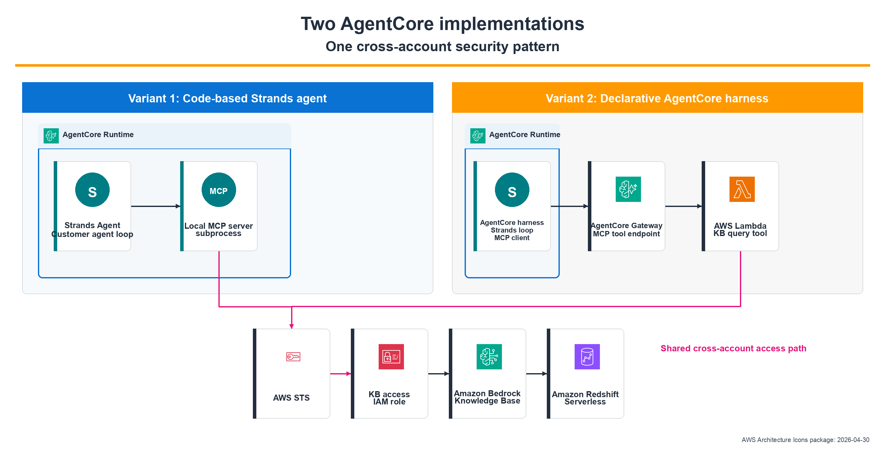
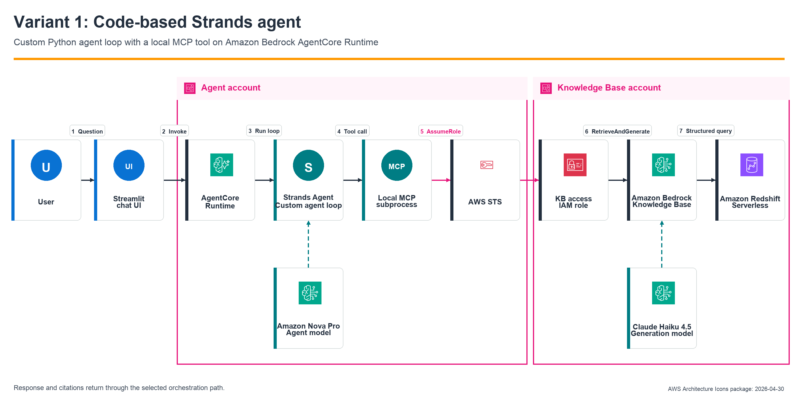
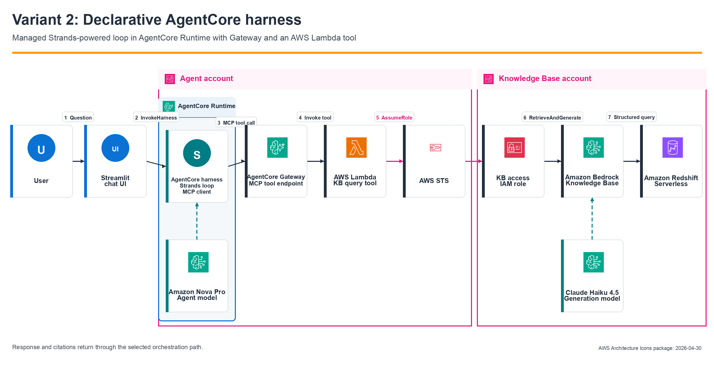

# Cross-Account Knowledge Base Queries with Amazon Bedrock AgentCore

This project demonstrates two ways to use **Amazon Bedrock AgentCore** to query a Knowledge Base in a different AWS account: a code-based **Strands Agent** on AgentCore Runtime and a declarative **AgentCore harness**. The Knowledge Base connects to Amazon Redshift Serverless for structured data, and a Streamlit chat interface supports end-to-end testing.

> **Note:** This project reimplements the cross-account Knowledge Base pattern from [Connect Amazon Bedrock Agents to Cross-Account Knowledge Bases](https://medium.com/@dwexpertkg/connect-amazon-bedrock-agents-to-cross-account-knowledge-bases-02694e900d8a) using both a Strands agent on AgentCore Runtime and an AgentCore harness.

## Challenge

Organizations that build AI agents using Amazon Bedrock often maintain structured data in Amazon Redshift in a separate AWS account. Amazon Bedrock Knowledge Bases resource policies support cross-account `Retrieve` and `GetDocumentContent`, but the [supported resource-policy actions](https://docs.aws.amazon.com/bedrock/latest/userguide/kb-managed-cross-account.html) do not include `RetrieveAndGenerate`. This sample uses `RetrieveAndGenerate` to return a generated answer from a structured Knowledge Base, so its tool assumes a role in the Knowledge Base account before making the request.

This pattern is useful for organizations that want to:

* Use generated answers over existing structured data in Amazon Redshift
* Preserve account boundaries between agent workloads and data workloads
* Avoid copying data into the agent account
* Grant least-privilege access through a dedicated cross-account role

## Solution Overview

This repository implements the cross-account query pattern in two ways: a **Strands Agent** deployed to AgentCore Runtime, and a **declarative AgentCore harness**. In both variants, a tool uses AWS STS `AssumeRole` to query a Knowledge Base in another account. An interactive **Streamlit chat UI** supports local and deployed end-to-end testing with real-time token streaming.

> The two variants demonstrate the same business outcome, but they are not drop-in replacements. The choice determines who owns the agent loop, how tools are hosted, which IAM principal crosses the account boundary, and which infrastructure you operate. See [Two Variants in This Repo](#two-variants-in-this-repo) before choosing an implementation.

The following overview highlights the execution boundary shared by the two implementations. In Variant 1, the customer-managed Strands loop and local MCP server subprocess are packaged together inside AgentCore Runtime. In Variant 2, the managed Strands-powered harness loop and its MCP client run inside AgentCore Runtime; AgentCore Gateway and the AWS Lambda tool remain separate managed resources.



### Architecture *(Variant 1 — code-based agent)*



The diagram uses the official [AWS Architecture Icons package dated April 30, 2026](https://aws.amazon.com/architecture/icons/). Neutral labeled shapes represent non-AWS components such as Streamlit, Strands, and the local MCP
subprocess. The blue AgentCore Runtime boundary shows which components execute in the same runtime session.

**Data flow (Variant 1 — code-based agent):**

1. The Streamlit client calls `InvokeAgentRuntime`; applications can also call this API directly.
2. Inside AgentCore Runtime, the Strands agent processes the request and calls the `query_knowledge_base` MCP tool.
3. The local MCP server subprocess (`kb_mcp_server.py`), packaged in the same runtime workload, assumes the KB access role through AWS STS using auto-refreshing credentials.
4. It calls `retrieve_and_generate` on the Bedrock Knowledge Base using Claude Haiku 4.5 with a cross-region inference profile.
5. The Knowledge Base queries Amazon Redshift Serverless for structured data.
6. The generated response streams back token-by-token to the user.

### Architecture *(Variant 2 — declarative harness)*



**Data flow (Variant 2 — declarative harness):**

1. The Streamlit client calls `InvokeHarness`; applications can also call this API directly.
2. Inside AgentCore Runtime, the AgentCore harness runs the managed Strands-powered loop and uses its MCP client to call the selected Knowledge Base tool through AgentCore Gateway.
3. AgentCore Gateway, which is outside the runtime boundary, invokes the Lambda tool.
4. The Lambda function assumes the KB access role via AWS STS using auto-refreshing credentials.
5. It calls `retrieve_and_generate` on the Bedrock Knowledge Base using Claude Haiku 4.5 with a cross-region inference profile.
6. The Knowledge Base queries Amazon Redshift Serverless for structured data.
7. The generated response streams back through the harness to the user.

## Two Variants in This Repo

This repository demonstrates the same cross-account Knowledge Base security pattern through two AgentCore orchestration models. The cross-account requirement itself does not favor either variant: both use a narrowly scoped role in the Knowledge Base account. Choose based on how much of the agent loop your team needs to customize and operate.

> **Decision in one sentence:** Choose the code-based Strands variant when custom orchestration is a product requirement. Choose the harness when its managed agent loop fits your use case and you prefer a configuration-first operating model.

| Decision area | **Variant 1 — Code-Based Strands Agent** | **Variant 2 — Declarative AgentCore harness** |
| --- | --- | --- |
| **Location** | [`strands_agent/`](strands_agent/) | [`harness_variant/`](harness_variant/) |
| **Choose it when** | You need custom planning or control flow, framework hooks, middleware, retry behavior, detailed instrumentation, or direct ownership of tool dispatch and streaming | A standard managed agent loop meets the requirement and you want model, prompt, tools, memory, and loop limits managed primarily as configuration |
| **Agent loop** | Your Python code runs the loop with the Strands Agents SDK inside AgentCore Runtime | AgentCore runs the Strands-powered loop from the harness definition inside AgentCore Runtime |
| **What you maintain** | `agent.py`, Python dependencies, the local MCP server, tool logic, and runtime configuration | Harness configuration and the Lambda tool; AgentCore manages the orchestration loop and MCP client |
| **Tool path** | AgentCore Runtime (Strands loop → local MCP server subprocess) → Knowledge Base | AgentCore Runtime (managed harness loop and MCP client) → AgentCore Gateway MCP endpoint → Lambda → Knowledge Base |
| **Infrastructure shape** | AgentCore Runtime and memory; the Strands loop and MCP server are packaged in the same runtime workload | A managed harness inside AgentCore Runtime, plus memory, Gateway, and Lambda; this adds a managed tool-routing hop and a possible Lambda cold start |
| **Cross-account principal** | AgentCore Runtime execution role | Lambda execution role behind the Gateway |
| **Invocation API** | `InvokeAgentRuntime` | `InvokeHarness` |
| **Service maturity** | AgentCore Runtime is generally available | AgentCore harness is generally available |
| **Get started** | [Implementation Walkthrough](#implementation-walkthrough) and [Running the Agent](#running-the-agent) | [Harness Variant](#variant-2--declarative-harness-managed-agent-loop) |

Both variants are working implementations and can be deployed side by side. They share the
Knowledge Base access role and setup artifacts, so they are operationally related and the
[cleanup order](#cleanup) matters. The main walkthrough covers Variant 1; the
self-contained [Variant 2 section](#variant-2--declarative-harness-managed-agent-loop) covers the
Harness.

### Which variant should I choose?

Use **Variant 1** when the orchestration behavior is part of your application logic. It is the better fit for teams that already use Strands, need nonstandard planning or error handling, want agent-local MCP integration, or must instrument and test each loop transition directly. The tradeoff is ownership of more Python code and its dependency lifecycle.

Use **Variant 2** when the managed harness loop already provides the behavior you need. It is the better fit when your team wants a configuration-first lifecycle, managed session isolation and loop execution, and centralized tool access through AgentCore Gateway. You still own and test the system prompt, tool implementation, IAM permissions, data access, and application-level behavior; the harness removes custom **orchestration** code, not customer responsibility for the solution.

Before choosing an agent variant, use this decision order:

1. If the workload only needs retrieved content, evaluate a Knowledge Base resource policy with native cross-account `Retrieve`.
2. If every request deterministically needs one generated answer, with no tool selection, multi-step reasoning, or conversational state, assume the KB-account role and call `RetrieveAndGenerate` directly from an application or Lambda function.
3. Use an agent when the model must decide when or how to query the Knowledge Base as part of a broader conversation or tool-using workflow. Then choose Variant 1 or Variant 2 based on who should own the orchestration loop.

## Project Structure

```text
.
├── images/
│   ├── architecture_overview.png    # Shared execution-boundary overview
│   ├── architecture.drawio          # Variant 1 architecture diagram, editable (draw.io)
│   ├── architecture.png             # Variant 1 architecture diagram (PNG export)
│   ├── architecture_harness.drawio  # Variant 2 architecture diagram, editable (draw.io)
│   ├── architecture_harness.png     # Variant 2 architecture diagram (PNG export)
│   └── aws-icons/                   # Official AWS icon assets used by the generator
├── strands_agent/
│   ├── agent.py               # Strands Agent + AgentCore entrypoint (streaming)
│   ├── kb_mcp_server.py       # MCP server exposing query_knowledge_base tool
│   ├── config.json            # Agent configuration (auto-generated by setup script)
│   └── requirements.txt       # Agent dependencies
├── streamlit_app/
│   ├── app.py                 # Streamlit chat interface (Local + AgentCore + Harness modes)
│   └── requirements.txt       # Streamlit dependencies
├── harness_variant/           # Variant 2 — declarative harness (see Two Variants section)
│   └── strandskbharness/      # AgentCore harness project (harness + Gateway + Lambda)
│       ├── agentcore/         # Config templates, generated local config, and CDK app
│       ├── app/strands_kb_harness/  # Harness template + generated local definition
│       └── tools/kb_query/    # Lambda tool: cross-account KB query (handler.py + config.json.template)
├── scripts/
│   ├── create_strands_agentcore_roles_policies.sh   # IAM setup + memory resource creation
│   ├── configure_harness_variant.sh                  # Generate local harness config from templates
│   ├── delete_strands_agentcore_roles_policies.sh   # IAM-only cleanup
│   ├── cleanup_all.sh                               # Code runtime + shared IAM cleanup
│   ├── cleanup_harness_variant.sh                   # Cleanup for the harness variant (stack + trust revert)
│   └── generate_architecture_diagrams.py            # Regenerate both PNG and draw.io diagrams
├── README.md
├── LICENSE
├── CODE_OF_CONDUCT.md
└── CONTRIBUTING.md
```

## Prerequisites

1. **Two AWS accounts** – one for the agent (*agent*), one for the knowledge base (*agent-kb*).
2. **AWS CLI** v2.24.22+ configured with profiles for both accounts:

   ```bash
   aws configure --profile agent       # Agent account credentials (for example, mntz)
   aws configure --profile agent-kb    # KB account credentials
   ```

3. **Python 3.10+**
4. **jq** – `brew install jq` (macOS) or `sudo apt install jq` (Linux)
5. **pip packages** – installed per section below.

## Assumptions

| Profile    | AWS Account    | Description                          |
|------------|----------------|--------------------------------------|
| `agent`    | 111122223333   | Account for the Strands Agent        |
| `agent-kb` | 999999999999   | Account for the Knowledge Base       |

* Region: **us-west-2** (Oregon)
* Agent model: **us.amazon.nova-pro-v1:0**
* KB model: **us.anthropic.claude-haiku-4-5-20251001-v1:0** (Claude Haiku 4.5, 200K context)

> Replace placeholder account numbers with your actual 12-digit account numbers.

Profile names are local aliases, not resource names. For example, when the AgentCore account is configured as `agent` and the Knowledge Base account as `agent-kb`, discover the account IDs and available Knowledge Bases instead of hardcoding them.

```bash
AGENT_PROFILE=agent
AGENT_KB_PROFILE=agent-kb
REGION=us-west-2

AGENT_ACCOUNT=$(aws sts get-caller-identity \
    --profile "$AGENT_PROFILE" --query Account --output text)
AGENT_KB_ACCOUNT=$(aws sts get-caller-identity \
    --profile "$AGENT_KB_PROFILE" --query Account --output text)
aws bedrock-agent list-knowledge-bases \
    --profile "$AGENT_KB_PROFILE" \
    --region "$REGION" \
    --query 'knowledgeBaseSummaries[].{name:name,id:knowledgeBaseId,status:status}'
```

Use the discovered values with the commands below. The examples use `agent` as the generic Agent account profile; substitute `$AGENT_PROFILE` or your own profile name.

---

## Implementation Walkthrough

### Step 1: Note your AWS account numbers

Record the 12-digit account numbers for both accounts as shown in the table above.

### Step 2: Create the Amazon Redshift Serverless workgroup (agent-kb account)

Follow the [workshop link](https://catalog.us-east-1.prod.workshops.aws/workshops/a0b74876-043f-4cdb-9024-ce2b8471542d/en-US/getting-started/using-your-aws-account/019-cloudformation) to create the Redshift Serverless workgroup in a private subnet.

### Step 3: Set up your data warehouse (agent-kb account)

[Set up your data warehouse](https://catalog.us-east-1.prod.workshops.aws/workshops/a0b74876-043f-4cdb-9024-ce2b8471542d/en-US/dataloads-configurations/enabletpch) in the agent-kb account.

### Step 4: Create your AI knowledge base (agent-kb account)

[Create your AI knowledge base](https://catalog.us-east-1.prod.workshops.aws/workshops/a0b74876-043f-4cdb-9024-ce2b8471542d/en-US/dataloads-configurations/createkb). **Make a note of the Knowledge Base ID.**

### Step 5: Train your AI Assistant (agent-kb account)

[Train your AI Assistant](https://catalog.us-east-1.prod.workshops.aws/workshops/a0b74876-043f-4cdb-9024-ce2b8471542d/en-US/dataloads-configurations/configurekb).

### Step 6: Test natural language queries (agent-kb account)

[Test natural language queries](https://catalog.us-east-1.prod.workshops.aws/workshops/a0b74876-043f-4cdb-9024-ce2b8471542d/en-US/dataloads-configurations/testkb) directly in the console.

### Step 7: Create IAM roles, policies, and AgentCore Memory

Run the script to create the necessary IAM roles in both accounts and provision the AgentCore Memory resource:

```bash
scripts/create_strands_agentcore_roles_policies.sh \
    --agent-profile agent \
    --agent-kb-profile agent-kb \
    --agentcore-role strands_agentcore_execution_role \
    --kb-access-role bedrock_kb_access_role \
    --kb-access-policy bedrock_kb_access_policy \
    --agentcore-policy strands_agentcore_sts_policy \
    --knowledge-base-id YOUR_KB_ID \
    --agent-account 111122223333 \
    --agent-kb-account 999999999999
```

| Parameter | Description |
| --- | --- |
| `--agent-profile` | AWS CLI profile for the agent account |
| `--agent-kb-profile` | AWS CLI profile for the KB account |
| `--agentcore-role` | Name for the AgentCore execution role (agent account) |
| `--kb-access-role` | Name for the KB access role (agent-kb account) |
| `--kb-access-policy` | Name for the KB access policy |
| `--agentcore-policy` | Name for the AgentCore STS + Bedrock policy |
| `--knowledge-base-id` | Bedrock Knowledge Base ID from Step 4 |
| `--agent-account` | 12-digit agent account number |
| `--agent-kb-account` | 12-digit agent-kb account number |

The script creates:

* **Agent account**: AgentCore execution role (trust: `bedrock-agentcore.amazonaws.com`) with policy for `sts:AssumeRole`, `bedrock:InvokeModel`, and AgentCore Memory actions.
* **Agent-KB account**: KB access role (trust: AgentCore role) with policy for `bedrock:Retrieve`, `bedrock:InvokeModel` (foundation models + inference profiles), and `bedrock:RetrieveAndGenerate`.
* **AgentCore Memory**: A memory resource named `cross_account_kb_memory` is created automatically (idempotent — skipped if it already exists). The Memory ID is written directly into `config.json`.
* **`strands_agent/config.json`**: Auto-generated configuration file with `KNOWLEDGE_BASE_ID`, `TARGET_ROLE_ARN`, `AGENTCORE_MEMORY_ID`, and other settings. This file is deployed alongside the agent code to AgentCore. **Note:** `config.json` is fully overwritten on every run — see [Configuration Reference](#configjson-primary--deployed-with-agent) before hand-editing.

The setup script is safe to rerun with changed account, role, or Knowledge Base inputs: existing managed policies receive a new default version, and existing unrelated KB-role trust statements (including the optional Harness Lambda grant) are preserved. It also removes stale IAM unique IDs (`AROA...`) left behind when a previously trusted role was deleted, because IAM rejects those identifiers when the trust policy is updated.

### Step 8: Check for model access in us-west-2

1. **Agent account**: Ensure **Nova Pro** (`us.amazon.nova-pro-v1:0`) access is enabled in the Bedrock console.
2. **Agent-KB account**: Ensure **Claude Haiku 4.5** (`us.anthropic.claude-haiku-4-5-20251001-v1:0`) access is enabled.

---

## Running the Agent

### Option A: Local Testing (Interactive REPL)

```bash
# Create and activate virtual environment (skip if already created)
python3 -m venv .venv
source .venv/bin/activate

# Install dependencies
cd strands_agent
pip install -r requirements.txt

# config.json was auto-generated by the setup script (Step 7).
# You can override any value via environment variables if needed:
export AWS_PROFILE=agent
export BYPASS_TOOL_CONSENT=true

# TARGET_ROLE_ARN: for local testing, this must be the bedrock_kb_access_role in the
# agent-kb account. The setup script configures trust for both the AgentCore execution
# role and the agent account root, so local testing works without extra IAM changes.
# config.json already has this set correctly if generated by the setup script.
export TARGET_ROLE_ARN="arn:aws:iam::<agent-kb-account>:role/bedrock_kb_access_role"

# Run interactive REPL
python3 agent.py

# Or one-shot mode
python3 agent.py "who are the top 5 customers in saudi ARABIA"

# When done, deactivate and return to repo root before running another option:
deactivate
cd ..
```

`BYPASS_TOOL_CONSENT=true` is an explicit opt-out appropriate only for this
trusted local sample. Do not set it for shared or production-facing clients
without replacing it with an application-specific approval control.

> **Note:** Environment variables take priority, with `strands_agent/config.json` used as the fallback. `kb_mcp_server.py` is launched automatically as a subprocess on first run, so no manual startup is needed.

### Option B: Streamlit Chat UI

```bash
# Create and activate virtual environment (skip if already created)
python3 -m venv .venv
source .venv/bin/activate

# Install dependencies
cd streamlit_app
pip install -r requirements.txt

# config.json was auto-generated by the setup script (Step 7).
# The sidebar uses environment variables first and config.json as its fallback.
export AWS_PROFILE=agent
# Required only for Local mode in this trusted local sample.
export BYPASS_TOOL_CONSENT=true
# Optional override; omit this when config.json already has the correct role.
export TARGET_ROLE_ARN="arn:aws:iam::<agent-kb-account>:role/bedrock_kb_access_role"

# Launch Streamlit
streamlit run app.py

# When done, deactivate and return to repo root before running another option:
deactivate
cd ..
```

The Streamlit UI provides:

* **Local mode**: Runs the agent in-process (default). No deployment needed. Sidebar defaults come from environment variables, then `strands_agent/config.json`.
* **AgentCore mode**: Calls the deployed AgentCore endpoint with **real-time token streaming** — responses appear as they are generated rather than waiting for the full answer.
* **Harness mode**: Calls the deployed [Variant 2 harness](#variant-2--declarative-harness-managed-agent-loop) via the `InvokeHarness` API, also with streaming.
* **Sidebar**: Configure KB ID, Target Role ARN, region, and model for Local mode. AgentCore and Harness use configuration packaged with their deployed resources, so Local-only fields are read-only in those modes.
* **New conversation**: Clears the UI history and creates fresh Local, AgentCore, and Harness sessions so independent factual tests do not inherit prior context.
* **Sample queries**: Click any sample query button to test instantly.

### Option C: Deploy to Amazon Bedrock AgentCore

```bash
# Create and activate virtual environment (skip if already created)
python3 -m venv .venv
source .venv/bin/activate

# Install agent dependencies
cd strands_agent
pip install -r requirements.txt

# Verify config.json exists (auto-generated by the setup script in Step 7)
# AGENTCORE_MEMORY_ID should be populated — if empty, re-run the setup script.
cat config.json

# Configure the agent
# --disable-memory: skip toolkit-managed memory. The agent uses the project-managed
# AgentCore Memory referenced via AGENTCORE_MEMORY_ID in config.json (created by the
# setup script in Step 7). Without this flag the toolkit auto-creates a redundant
# short-term memory on first deploy.
agentcore configure \
    --entrypoint agent.py \
    --name strands_kb_query_agent \
    --execution-role arn:aws:iam::<agent-account>:role/strands_agentcore_execution_role \
    --region us-west-2 \
    --deployment-type direct_code_deploy \
    --runtime PYTHON_3_11 \
    --requirements-file requirements.txt \
    --disable-memory \
    --non-interactive \
    --verbose

# Deploy to AWS (config.json and kb_mcp_server.py are packaged with the agent code)
# NOTE: All agentcore commands (deploy/invoke/status) must be run from the strands_agent/
# directory. The CLI looks for .bedrock_agentcore.yaml in the current directory — running
# from any other directory will result in a ".bedrock_agentcore.yaml not found" error.
agentcore deploy

# Test the deployed agent
agentcore invoke '{"prompt": "who are the top 5 customers in saudi ARABIA"}'

# Test with session persistence (multi-turn — memory is enabled when AGENTCORE_MEMORY_ID is set)
agentcore invoke '{"prompt": "who are the top 5 customers in saudi ARABIA"}' --session-id "a1b2c3d4-e5f6-7890-abcd-ef1234567890"
agentcore invoke '{"prompt": "now show me for united states"}' --session-id "a1b2c3d4-e5f6-7890-abcd-ef1234567890"

# The runtime restores the immediately preceding user request for follow-up
# context, but excludes historical assistant answers and tool results. This
# prevents cached database facts from replacing a fresh Knowledge Base query.

# Check deployment status
agentcore status --verbose

# When done, deactivate and return to repo root before running another option:
deactivate
cd ..
```

> **Important:** `config.json` and `kb_mcp_server.py` in `strands_agent/` are deployed alongside `agent.py`. This is how the deployed agent knows the `KNOWLEDGE_BASE_ID`, `TARGET_ROLE_ARN`, and `AGENTCORE_MEMORY_ID` — environment variables from your local shell are **not** carried over to the AgentCore runtime.
>
> Variant 1 uses the Python `bedrock-agentcore` CLI from the active virtual environment. Variant 2
> uses the Node `@aws/agentcore` CLI. Both install a command named
> `agentcore`; activate the Python virtual environment for Variant 1, and use the Node CLI outside
> that environment for Variant 2.
>
> AgentCore sessions remain pinned to the runtime version on which they started. After deploying
> updated runtime code, invoke it with a new session ID or select **New conversation** in Streamlit.

Once deployed, you can also use the **Streamlit chat UI in AgentCore mode** to interact with the deployed agent with real-time streaming:

```bash
# Retrieve the code-based runtime ARN. This also works if the deployment
# output is no longer available.
export AGENTCORE_RUNTIME_ARN="$(
    aws bedrock-agentcore-control list-agent-runtimes \
        --profile agent \
        --region us-west-2 \
        --query "agentRuntimes[?agentRuntimeName=='strands_kb_query_agent'].agentRuntimeArn | [0]" \
        --output text
)"

# After deploying Variant 2, retrieve its harness ARN from the stack output.
export AGENTCORE_HARNESS_ARN="$(
    aws cloudformation describe-stacks \
        --stack-name AgentCore-strandskbharness-default \
        --profile agent \
        --region us-west-2 \
        --query "Stacks[0].Outputs[?contains(OutputKey, 'HarnessArn')].OutputValue | [0]" \
        --output text
)"

printf 'AgentCore runtime: %s\nHarness: %s\n' \
    "$AGENTCORE_RUNTIME_ARN" "$AGENTCORE_HARNESS_ARN"

# Required only when testing Local mode from the same Streamlit process.
export BYPASS_TOOL_CONSENT=true

# Launch Streamlit
cd streamlit_app
streamlit run app.py
```

Open either direct link after Streamlit starts:

* Code-based AgentCore runtime: [http://localhost:8501/?mode=AgentCore](http://localhost:8501/?mode=AgentCore)
* Declarative Harness: [http://localhost:8501/?mode=Harness](http://localhost:8501/?mode=Harness)

The query parameter selects the mode, and the corresponding ARN is prefilled from the environment.

### Option D: All-in-One Quick Start

```bash
# 1. Clone and enter the repo
cd sample-for-strands-agentcore-connect-cross-account-kb

# 2. Create a virtual environment
python3 -m venv .venv
source .venv/bin/activate

# 3. Install Streamlit and Local-mode agent dependencies
pip install -r streamlit_app/requirements.txt

# 4. Run the IAM setup script (Step 7) — generates strands_agent/config.json
#    with KNOWLEDGE_BASE_ID, TARGET_ROLE_ARN, and AGENTCORE_MEMORY_ID pre-configured.

# 5. Set AWS profile
export AWS_PROFILE=agent
export BYPASS_TOOL_CONSENT=true
export TARGET_ROLE_ARN="arn:aws:iam::<agent-kb-account>:role/bedrock_kb_access_role"

# 6. Launch Streamlit (includes local agent)
cd streamlit_app
streamlit run app.py

# When done, deactivate and return to repo root before running another option:
deactivate
cd ..
```

---

## Variant 2 — Declarative harness (Managed Agent Loop)

> This is the second of two variants in this repository. It has its own deployment stack, but reuses the IAM roles and setup artifacts from [Step 7](#step-7-create-iam-roles-policies-and-agentcore-memory). Review [Two Variants in This Repo](#two-variants-in-this-repo) before choosing it.

AgentCore harness provides a declarative, managed agent loop powered by Strands Agents. The harness is a managed abstraction that runs inside AgentCore Runtime. Instead of writing and deploying `agent.py` for model selection, tool wiring, and loop execution, you declare the model, system prompt, memory, loop limits, and tools in configuration. AgentCore runs the loop and its MCP
client inside the runtime session.

The deployable harness implementation lives under [`harness_variant/strandskbharness/`](harness_variant/strandskbharness/). It does not replace the Strands `agent.py` deployment; both variants can run side by side, subject to their shared IAM setup and documented cleanup order.

> For a side-by-side comparison of the two variants, see [Two Variants in This Repo](#two-variants-in-this-repo).

### Architecture *(Variant 2 — declarative harness)*


The editable diagram lives at [`images/architecture_harness.drawio`](images/architecture_harness.drawio). In this implementation, customer tool code does not run inside the managed agent loop. The cross-account `sts:AssumeRole` and `retrieve_and_generate` logic from `kb_mcp_server.py` is relocated into a separate **AWS Lambda** function and exposed to the harness through an **AgentCore Gateway** MCP endpoint.

```text
AgentCore Runtime [AgentCore harness: managed Strands loop + MCP client]
  → AgentCore Gateway MCP endpoint (AWS_IAM auth)
  → Lambda tool (CDK-built from tools/kb_query/, sts:AssumeRole in its execution role)
  → STS AssumeRole → agent-kb account
  → bedrock:retrieve_and_generate → Knowledge Base → Redshift Serverless
```

To regenerate all architecture diagrams after changing their shared layout, install [Pillow](https://pypi.org/project/pillow/) and run.

```bash
python scripts/generate_architecture_diagrams.py
```

### Harness Prerequisites

* **Current AgentCore CLI `@aws/agentcore`** (`npm install -g @aws/agentcore`). Run `agentcore --version` to confirm the Node CLI is selected.
* The IAM roles from [Step 7](#step-7-create-iam-roles-policies-and-agentcore-memory) — in particular the KB access role (`bedrock_kb_access_role`) in the agent-kb account.

### Deploy

```bash
cd harness_variant/strandskbharness

# One-time setup — generate gitignored local config from committed templates.
../../scripts/configure_harness_variant.sh \
    --agent-account 111122223333 \
    --agent-kb-account 999999999999 \
    --knowledge-base-id YOUR_KB_ID

# Validate the declarative config (harness + gateway + Lambda tool)
agentcore validate

# Phase 1 — deploy the Gateway, Lambda tool, harness, and memory (own CFN stack)
AWS_PROFILE=agent agentcore deploy --yes
```

The first deployment bootstraps the CDK environment when needed. Bootstrap and AgentCore Memory creation can take several minutes; wait for the command to finish and the Memory to become `ACTIVE`.

After Phase 1, grant the new Lambda execution role permission to assume the KB access role. Add a statement to `bedrock_kb_access_role`'s trust policy in the **agent-kb** account (keep the existing statements).

```json
{
    "Sid": "AllowHarnessLambdaRole",
    "Effect": "Allow",
    "Principal": { "AWS": "<lambda-execution-role-arn>" },
    "Action": "sts:AssumeRole"
}
```

> The stack does not output the Lambda execution role ARN directly — fetch it from the deployed function:
> `aws lambda get-function --function-name strandskbharness-kbquery --query Configuration.Role`.

Then attach the deployed Gateway and complete Phase 2.

```bash
# The Gateway ARN is printed by Phase 1 (GatewayStrandsKbGatewayArnOutput).
agentcore add tool \
    --harness strands_kb_harness \
    --type agentcore_gateway \
    --name kb_gateway_tool \
    --gateway-arn <gateway-arn-from-deploy-output> \
    --outbound-auth awsIam
AWS_PROFILE=agent agentcore deploy --yes
```

### Invoke

```bash
# From the repository root:
cd harness_variant/strandskbharness
AWS_PROFILE=agent agentcore invoke \
    --harness strands_kb_harness \
    "What is the total number of customers?"
```

You can also drive it from the **Streamlit UI in Harness mode** — select **Harness** in the sidebar and paste the harness ARN (`arn:aws:bedrock-agentcore:...:harness/...`), or pre-fill it.

```bash
# From the repository root:
export AGENTCORE_HARNESS_ARN="$(
    aws cloudformation describe-stacks \
        --stack-name AgentCore-strandskbharness-default \
        --profile agent \
        --region us-west-2 \
        --query "Stacks[0].Outputs[?contains(OutputKey, 'HarnessArn')].OutputValue | [0]" \
        --output text
)"
cd streamlit_app && streamlit run app.py
```

Open [http://localhost:8501/?mode=Harness](http://localhost:8501/?mode=Harness) to select Harness mode directly.

### Notes & gotchas

* **Lambda timeout:** cross-account `retrieve_and_generate` against Redshift can take 10–50s. The tool's `compute.timeout` is set to 180s (the Lambda default of 3s is far too low).
* **Tool name characters:** the gateway target name becomes part of the model-visible tool name (`<target>___<tool>`). Keep it **alphanumeric** — Nova Pro can fail tool use (`modelStreamErrorException: Model produced invalid sequence as part of ToolUse`) when the name contains hyphens.
* **No env vars on the Lambda tool:** the compute block has no environment-variable field, so the tool reads its settings from a bundled `tools/kb_query/config.json` (same pattern as the code-based agent).
* **Credentials refresh automatically:** the Lambda's cached Bedrock client uses botocore `RefreshableCredentials`, so a warm execution environment can outlive an individual STS session without eventually failing with `ExpiredToken`.
* **Deployment values stay local:** `agentcore.json`, `aws-targets.json`, `harness.json`, and the Lambda's `config.json` are generated and gitignored. Commit their `.template` files instead.

### Harness Cleanup

```bash
# From the repository root:
scripts/cleanup_harness_variant.sh \
    --agent-profile agent \
    --agent-kb-profile agent-kb \
    --agent-account 111122223333 \
    --agent-kb-account 999999999999
```

This deletes the harness CloudFormation stack (harness, Gateway, Lambda, memory) and removes the `AllowHarnessLambdaRole` statement from the KB access role's trust policy. It does **not** affect the original `agent.py` deployment. After AWS confirms that the stack is absent, the script also removes the generated local deployment-state file so a later deploy cannot reuse stale resource ARNs or a stale deploy hash.

---

## Sample Test Queries

These queries work with the TPC-H dataset in Redshift Serverless:

1. `who are the top 5 customers in saudi ARABIA`
2. `who are the top parts supplier in united states by volume`
3. `what is the total revenue by region for the year 1998`
4. `which products generated the highest revenue after discounts`
5. `show the 100 highest-value orders marked 1-URGENT from October 1 through December 31, 1997`

Keep row-returning questions bounded with an explicit row count, date range, and sort order. A structured Knowledge Base translates natural language to SQL; an unbounded question can produce an oversized result set and cause `RetrieveAndGenerate` to fail even when the invocation path and IAM configuration are healthy.

For row-returning queries, both variants render the structured rows from the Knowledge Base citations as a source-ordered Markdown table instead of relying on the generated summary, which might mention only a few example rows. The tool displays up to 100 rows and reports both the returned and displayed row counts.

## Results

In the Streamlit UI make sure to choose the right `Invocation mode` which can be `Local` or `AgentCore` or `Harness`. Make sure the right `ARN` is populated for `AgentCore` or `Harness`. Please refer to the screen shots below.


### Define derived business metrics before testing

A derived metric such as **profit margin** is not self-defining. It can mean list-price markup, realized gross margin, contribution margin, or another business-specific calculation. If the Knowledge Base has no curated query or column descriptions that define the metric, generated SQL can select incompatible formulas in response to wording or punctuation changes.

Define the approved formula with the data owner and add it to the structured Knowledge Base's curated queries and generation context before treating the answer as authoritative. For example, one possible TPC-H realized gross-margin definition is:

```text
revenue = SUM(l_extendedprice * (1 - l_discount))
cost = SUM(ps_supplycost * l_quantity)
gross_margin = (revenue - cost) / revenue
```

This is an example, not a default business definition. Use the formula your organization approves. The agents are instructed to ask for clarification when a metric is undefined and to pass the user's question to the tool without changing its wording. Existing deployments must be redeployed to receive that prompt update.

---

## Configuration Reference

### config.json (primary — deployed with agent)

The setup script (`create_strands_agentcore_roles_policies.sh`) auto-generates `strands_agent/config.json`:

```json
{
    "KNOWLEDGE_BASE_ID": "YOUR_KB_ID",
    "TARGET_ROLE_ARN": "arn:aws:iam::<agent-kb-account>:role/bedrock_kb_access_role",
    "KB_FOUNDATION_MODEL": "us.anthropic.claude-haiku-4-5-20251001-v1:0",
    "AGENT_MODEL_ID": "us.amazon.nova-pro-v1:0",
    "AGENT_MAX_TOKENS": "5000",
    "AWS_REGION": "us-west-2",
    "KB_NUM_RESULTS": "5",
    "AGENTCORE_MEMORY_ID": "<auto-populated by setup script>"
}
```

This file is deployed alongside the agent code to AgentCore. **Do not commit this file with real values to a public repository.**

> **`config.json` is fully overwritten every time `create_strands_agentcore_roles_policies.sh`
> runs.** The fields `KB_FOUNDATION_MODEL`, `AGENT_MODEL_ID`, `AGENT_MAX_TOKENS`,
> `AWS_REGION`, and `KB_NUM_RESULTS`
> are defaults in the script. If you need different values, either edit the script before running
> it, or override them with the environment variables in the next section. Manual edits to
> `config.json` will be lost on the next setup-script run.

### Environment Variables (override)

Environment variables take priority over `config.json` values:

| Variable | Default | Description |
| --- | --- | --- |
| `KNOWLEDGE_BASE_ID` | from `config.json` | Bedrock Knowledge Base ID |
| `TARGET_ROLE_ARN` | from `config.json` | ARN of the KB access role in agent-kb account. Leave empty for same-account. |
| `KB_FOUNDATION_MODEL` | `us.anthropic.claude-haiku-4-5-20251001-v1:0` | Foundation model for KB queries (supports cross-region inference profiles) |
| `AGENT_MODEL_ID` | `us.amazon.nova-pro-v1:0` | Foundation model for the Strands Agent |
| `AGENT_MAX_TOKENS` | `5000` | Maximum output tokens for the Strands Agent; supports complete 100-row Markdown tables with Nova Pro |
| `AWS_REGION` | `us-west-2` | AWS region |
| `AWS_PROFILE` | (system default) | AWS CLI profile to use |
| `KB_NUM_RESULTS` | `5` | Number of retrieval results from the Knowledge Base |
| `AGENTCORE_MEMORY_ID` | from `config.json` | AgentCore Memory resource ID for cross-session history. Leave empty to disable memory. |
| `BYPASS_TOOL_CONSENT` | (not set) | Set to `true` to skip tool consent prompts in local mode |
| `AGENTCORE_RUNTIME_ARN` | (not set) | ARN of the deployed AgentCore runtime (for Streamlit AgentCore mode) |
| `AGENTCORE_HARNESS_ARN` | (not set) | ARN of the deployed AgentCore harness (for Streamlit Harness mode) |

Changing Local-mode settings in the Streamlit sidebar restarts the MCP subprocess and recreates the browser-session agent automatically, so the next query uses the new Knowledge Base, role, model, and region values. Local conversation history is isolated by Streamlit browser session.

### Security defaults

The sample validates questions at the Streamlit, AgentCore runtime, MCP, and Gateway Lambda boundaries. Questions must be non-empty strings of 2,000 characters or fewer and cannot contain unsupported control characters. Runtime and tool errors return stable messages to callers while detailed exceptions remain in application or CloudWatch logs.

The Streamlit development server binds to `127.0.0.1` by default. Override `STREAMLIT_SERVER_ADDRESS` only when you intentionally place the UI behind an authenticated network boundary. AgentCore runtime and harness invocation use AWS IAM authorization; grant invoke permissions only to intended callers. The default runtime endpoint can be publicly routable, but it is not anonymous: requests must be authorized and signed. Select VPC networking when your organization requires private connectivity in addition to IAM authorization. The sample's system prompts also treat retrieved tool output as untrusted data and instruct the model not to follow embedded instructions or disclose internal configuration. Add Amazon Bedrock Guardrails and application-specific authorization when your use case requires additional input, output, topic, or data-access controls.

AgentCore mode derives its memory actor partition from the runtime session and stores only a hash of that value; it does not accept an actor namespace in the request payload. Production clients should derive runtime session IDs and harness `actorId` values from authenticated application state rather than accepting either value directly from a user.

## Tests

The focused unit suite covers configuration precedence, model ARN construction, Harness input validation and STS refresh, stream filtering, and sanitized deployment templates:

```bash
python -m unittest discover -s tests -v
```

The generated Harness CDK project also has a synthesis smoke test:

```bash
cd harness_variant/strandskbharness/agentcore/cdk
npm test -- --runInBand
```

---

## Troubleshooting

### Common Issues

1. **Role Assumption Failures**
   * Verify trust relationships are correctly configured.
   * Check that account numbers match exactly.
   * Ensure the AgentCore execution role or your local AWS profile has `sts:AssumeRole` permission on the KB access role.

2. **Knowledge Base Access Denied**
   * Confirm Knowledge Base ID is correct.
   * Verify the KB access policy includes `bedrock:Retrieve`, `bedrock:InvokeModel`, and `bedrock:RetrieveAndGenerate`.
   * Check that the Knowledge Base exists in the agent-kb account.

3. **Model Access Denied**
   * Ensure model access is enabled in both accounts (Step 8).
   * For cross-region inference profiles (`us.` prefix), the KB account IAM policy must allow `arn:aws:bedrock:*:<kb-account>:inference-profile/*` in addition to `arn:aws:bedrock:*::foundation-model/*`.

4. **Streamlit Import Error**
   * Make sure you installed dependencies: `pip install -r streamlit_app/requirements.txt`
   * Run Streamlit from the `streamlit_app/` directory.

5. **AgentCore Deployment Failures**
   * Check `agentcore status --verbose` for details.
   * Ensure the execution role ARN is correct.
   * For direct-code deployment, verify the required S3 and AgentCore permissions. CodeBuild and ECR permissions are only needed for container deployment.
   * Confirm `kb_mcp_server.py` is present in `strands_agent/` — it must be deployed alongside `agent.py`.

6. **Memory Not Persisting**
   * Confirm `AGENTCORE_MEMORY_ID` is set in `config.json` (auto-populated by the setup script).
   * If empty, re-run `create_strands_agentcore_roles_policies.sh`; its internal Step 6 creates the memory resource idempotently.

7. **Different Factual Answers for a Derived Metric**
   * Start a new conversation in each mode and verify that all modes use the same deployed Knowledge Base and models.
   * Inspect the exact tool query and generated SQL. Case or punctuation should not change the metric definition.
   * Add an approved curated query and column descriptions for the metric; do not rely on the model to invent a formula.
   * Validate signs, units, ranking, and returned rows against the underlying structured data before publishing the result.

### Debugging Steps

1. **Check logs**: Agent logs go to stdout (local) or CloudWatch (AgentCore).
2. **Validate IAM roles**: `aws sts assume-role --role-arn <TARGET_ROLE_ARN> --role-session-name test --profile agent`
3. **Test KB directly**: Query the KB from the agent-kb account console.
4. **Verbose agent output**: Set `LOG_LEVEL=DEBUG` for detailed tool invocation logs.

---

## Cleanup

When both variants are deployed, clean up the **Harness first** using [Harness Cleanup](#harness-cleanup). The Harness cleanup needs the shared KB access role in order to remove its trust grant. Then clean up the code-based runtime and shared IAM resources below.

### Option A: Code Variant and Shared IAM Cleanup

Destroys the code-based AgentCore runtime and deletes its shared IAM roles and policies:

```bash
# Select the Python Variant 1 CLI, not the Node Harness CLI.
source .venv/bin/activate

scripts/cleanup_all.sh \
    --agent-profile agent \
    --agent-kb-profile agent-kb \
    --agentcore-role strands_agentcore_execution_role \
    --kb-access-role bedrock_kb_access_role \
    --kb-access-policy bedrock_kb_access_policy \
    --agentcore-policy strands_agentcore_sts_policy \
    --agent-account 111122223333 \
    --agent-kb-account 999999999999
```

| Parameter | Description |
| --- | --- |
| `--agent-name` | AgentCore agent name (default: `strands_kb_query_agent`) |
| `--skip-agentcore-destroy` | Skip AgentCore destroy, only delete IAM resources |
| `--yes` | Skip confirmation prompt |

### Option B: Step-by-Step Cleanup

#### Step 1: Destroy AgentCore Deployment

```bash
source .venv/bin/activate
AWS_PROFILE=agent agentcore destroy --agent strands_kb_query_agent --force
```

#### Step 2: Delete IAM Resources

```bash
scripts/delete_strands_agentcore_roles_policies.sh \
    --agent-profile agent \
    --agent-kb-profile agent-kb \
    --agentcore-role strands_agentcore_execution_role \
    --kb-access-role bedrock_kb_access_role \
    --kb-access-policy bedrock_kb_access_policy \
    --agentcore-policy strands_agentcore_sts_policy \
    --agent-account 111122223333 \
    --agent-kb-account 999999999999
```

### Delete Redshift and Knowledge Base

Delete the Redshift Serverless workgroup and Knowledge Base from the agent-kb account console.

> **Note:** The AgentCore Memory resource (`cross_account_kb_memory`) is not deleted by the cleanup scripts. Delete it manually via the AWS console or CLI if no longer needed.

```bash
aws bedrock-agentcore-control delete-memory --memory-id <AGENTCORE_MEMORY_ID> --profile agent
```

---

## Cost Considerations

* **Bedrock AgentCore**: Pay per session and compute time (consumption-based).
* **Bedrock Models**: Pay per request and token usage (Nova Pro + Claude Haiku 4.5).
* **AgentCore Memory**: Pay per event stored and memory retrieval.
* **Redshift Serverless**: Pay per RPU-hour of compute.
* **Cross-Account Data Transfer**: May incur charges depending on region.

## Code of Conduct

See [CODE_OF_CONDUCT](CODE_OF_CONDUCT.md) for more information.

## Contributing Guidelines

See [CONTRIBUTING](CONTRIBUTING.md#security-issue-notifications) for more information.

## License

This library is licensed under the MIT-0 License. See the [LICENSE](LICENSE) file.
